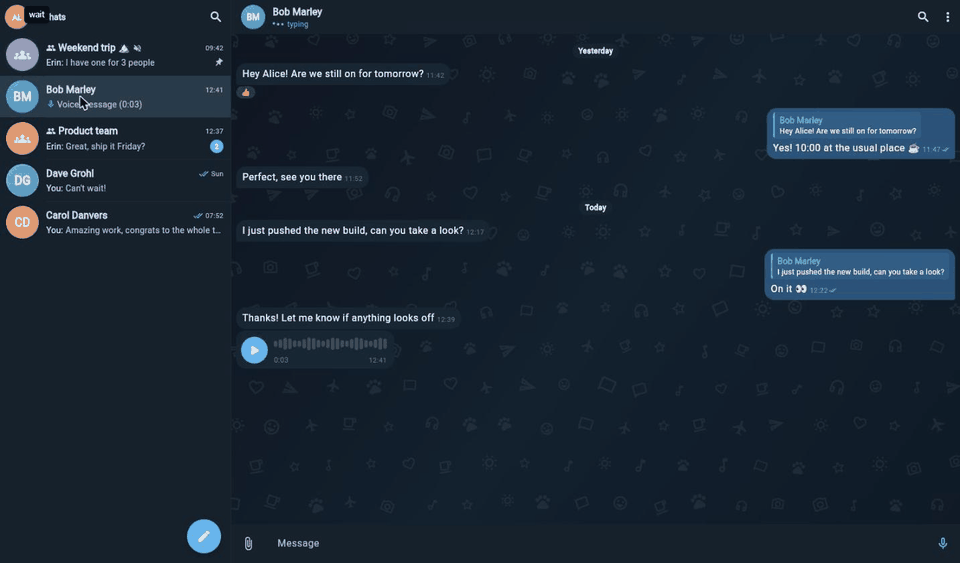
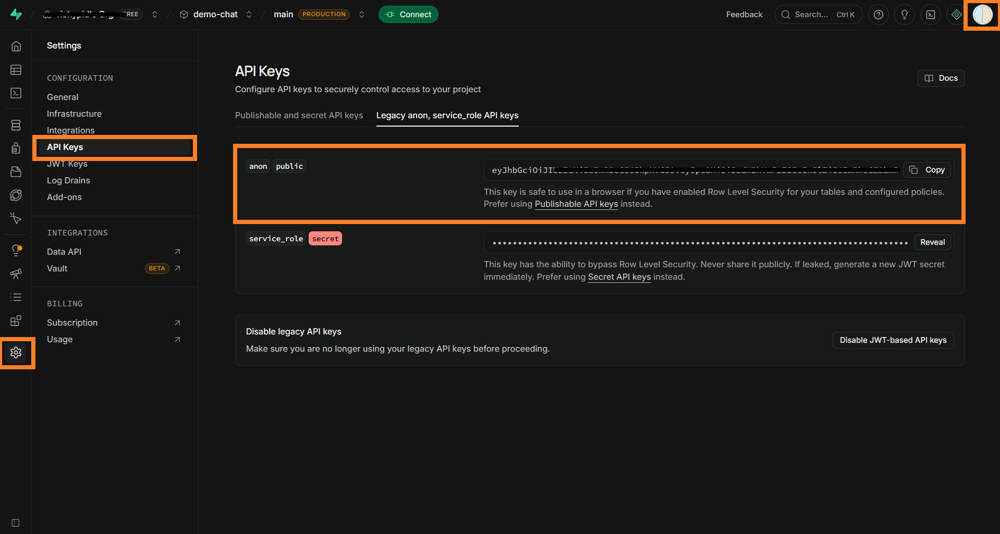
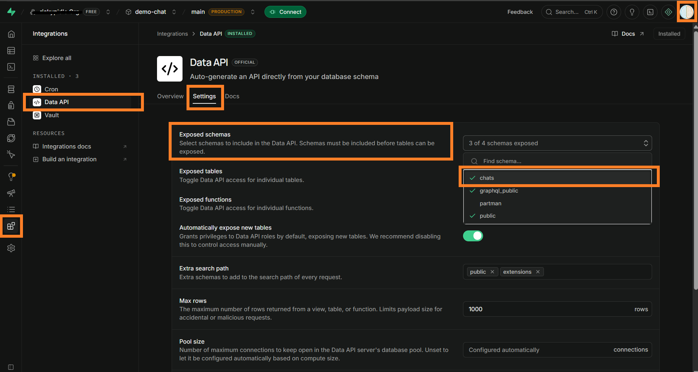
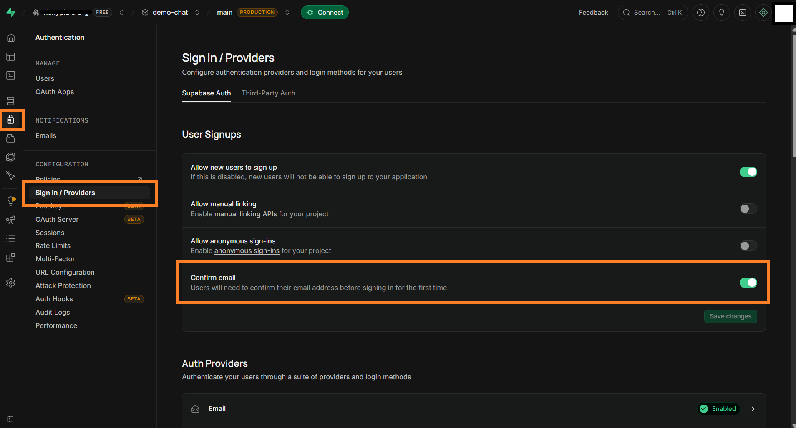

<br>

<p align="center">
  <a href="https://pub.dartlang.org/packages/flutter_supabase_chat_core">
    
  </a>
  <a href="https://pub.dev/packages/flutter_supabase_chat_core/score">
    
  </a>
  <a href="https://pub.dev/packages/flutter_supabase_chat_core/score">
    
  </a>
  <a href="https://github.com/insideapp-srl/flutter_supabase_chat_core/actions?query=workflow%3Abuild">
    
  </a>
  <a href="https://www.codefactor.io/repository/github/insideapp-srl/flutter_supabase_chat_core">
    
  </a>
</p>
<p align="center">
  <a href="https://github.com/insideapp-srl/flutter_supabase_chat_core">
    
  </a>
  <a href="https://github.com/insideapp-srl/flutter_supabase_chat_core/issues">
    
  </a>
  <a href="https://github.com/insideapp-srl/flutter_supabase_chat_core/blob/main/LICENSE">
    
  </a>
</p>

<p align="center">
  <a href="https://flyer.chat">
    
  </a>
</p>

<h1 align="center">Flutter Supabase Chat Core</h1>
<h2 align="center">Add chat support to your app in 10 minutes!</h2>
<br>

<p align="center">
    A <a href="https://supabase.com/">Supabase</a> backend for <a href="https://pub.dev/packages/flutter_chat_core">flutter_chat_core</a> and <a href="https://pub.dev/packages/flutter_chat_ui">flutter_chat_ui</a> 2.x: rooms, members, messages, attachments, read receipts, reactions, typing indicators and online status, over Postgres + RLS and Supabase Realtime.
</p>

<p align="center">
    ℹ️ Coming from 1.x (<code>flutter_chat_types</code>)? Read <a href="MIGRATION.md">MIGRATION.md</a>: 2.0 changes both the Dart API and the database schema. ℹ️
</p>

<br>

<p align="center">
  Actively maintained, community-driven Supabase BaaS for chat applications with an optional <a href="https://pub.dev/packages/flutter_chat_ui">chat UI</a>.
</p>

<br>

<p align="center">
    ⚠️⚠️ This project has been optimized to support scalability, but careful evaluation is recommended before integrating it into large-scale projects, considering specific requirements and available resources. ⚠️⚠️
</p>

<br>

<p align="center">
  
</p>

<p align="center">
  <sub>The example app on Supabase cloud: real-time messages and typing indicator, reactions, replies and voice messages.</sub>
</p>

<br>

Have you ever wanted to implement a chat in your application? Do you think it's difficult and complex?

Try this, thanks to the magnificent [Supabase](https://supabase.com/) platform and the [Flutter Chat UI](https://pub.dev/packages/flutter_chat_ui) package, you can achieve it in just a few minutes and effortlessly.

---

Flyer Chat is a platform for creating in-app chat experiences using Flutter. This repository contains Supabase BaaS implementation for Flutter. We are also working on our more advanced SaaS and self-hosted solutions.

* **Free, open-source and community-driven**. We offer no paid plugins and strive to create an easy-to-use, almost drop-in chat experience for any application. Contributions are more than welcome! Please read our [Contributing Guide](CONTRIBUTING.md).

* **Chat UI agnostic**. You can choose the chat UI you prefer. But if you don't have one, we provide our own free and open-source [Flutter Chat UI](https://pub.dev/packages/flutter_chat_ui), which can be used to create a working chat in minutes.

* **Secure by default**. Every table, storage bucket and Realtime channel is protected by [Postgres Row Level Security](https://supabase.com/docs/guides/database/postgres/row-level-security). Check our [documentation](https://flutter-supabase-chat-core.insideapp.it/guides/supabase-security) for the details.

## Features

- **Direct and group rooms**, created atomically by a database function. Direct rooms are de-duplicated per pair of users (and per metadata scope, see [Scoping](#scoping-workspaces-organizations)).
- **Group management**: per-room roles (`admin`, `moderator`), add/remove members, change roles, rename, leave, delete. A room left without members is deleted automatically.
- **Messages** of every `flutter_chat_core` type (text, image, file, audio with waveform, video, custom...), with replies, edits, reactions, pinned messages and search.
- **Optimistic sending**: messages appear right away, are reconciled with the stored row and can be retried when they fail.
- **Read receipts and unread counters**: `markRoomAsRead` flips other members' messages to `seen` and resets the room's `unreadCount`.
- **Per-user preferences**: pin a room on top of your list, mute it for a while or for ever.
- **Realtime everywhere**: message changes over private Broadcast channels, a throttled typing indicator, the rooms list kept in sync, online status over Presence.
- **Cursor-based pagination** for messages and offset pagination for rooms and users.
- **Attachments and avatars** in private Storage buckets, plus an Edge Function that deletes the files of deleted messages.
- **Scoping hooks** to keep the chats of different workspaces/organizations apart without forking the package.
- **Typed errors**: every failure surfaces as a `SupabaseChatCoreException`.
- **Scales with history**: `chats.messages` is partitioned by week with `pg_partman`, ids are time-ordered UUIDv7.

## Requirements

- `Dart >=3.8.0` and `Flutter >=3.32.0`.
- A [Supabase](https://supabase.com) project (cloud or self-hosted) with:
  - the `pg_partman` and `pg_cron` extensions available (the SQL scripts create them);
  - Realtime with **Broadcast from Database** support (Supabase cloud, or self-hosted `supabase/realtime` >= v2.33): message changes are sent by a database trigger;
  - the `chats` schema exposed through the Data API (see below).

## Installation

```yaml
dependencies:
  flutter_supabase_chat_core: ^2.0.0-rc.1
  supabase_flutter: ^2.17.2
  uuid: ^4.5.1

  # Optional, for the ready-made UI:
  flutter_chat_ui: ^2.11.1
  flyer_chat_text_message: ^2.6.0
  flyer_chat_image_message: ^2.3.0
  flyer_chat_file_message: ^2.4.0
```

`flutter_chat_ui` 2.x ships no renderer for images or files (only a minimal text fallback): add one `flyer_chat_*_message` package per message type you use. The example app pins `flutter_chat_ui: '>=2.11.1 <2.12.0'`: 2.12.0 moved the `Composer` to the experimental `material_ui` package, which crashes inside a standard `Scaffold` ("No Material widget found").

## Supabase setup

The database is set up by the SQL scripts in [`example/utils/sql`](example/utils/sql), applied in this order:

| Script | Content |
|--------|---------|
| `01_database_schema.sql` | Schema `chats`, tables, weekly partitions, indexes, `pg_cron` maintenance job. **Also migrates a 1.x database** (see [MIGRATION.md](MIGRATION.md)). |
| `02_database_trigger.sql` | Profile creation on sign-up, last message snapshot, `sent` status, media cleanup queue, empty room deletion, Realtime broadcast of message changes. |
| `03_database_policy.sql` | Access helpers, RPCs and RLS policies (tables and `realtime.messages`). |
| `04_storage.sql` | Buckets `chats_assets` and `chats_user_avatar` and their policies. |
| `05_database_view.sql` | Views `chats.rooms_l` and `chats.messages_l`. |
| `99_database_schema_permission.sql` | Final grants. |
| `06_cleanup_media_schedule.sql` | **Optional**: schedules the `cleanup-media` Edge Function (see [Media cleanup](#media-cleanup)). |

Every script is idempotent: re-running them is safe.

### Option A: create a project with the Supabase CLI

1. Install the [Supabase CLI](https://supabase.com/docs/guides/cli/getting-started) and log in with `supabase login`.
2. Linux/macOS only: install [`jq`](https://jqlang.org/download/).
3. Run the script from `example/utils`:

```bash
cd example/utils
./supabase_prepare.sh          # Linux/macOS
```

```powershell
cd example\utils
.\supabase_prepare.ps1         # Windows
```

It lets you create a new project (organization and region picked from a list, database password generated for you) or pick an existing one (it then asks for its database password), fetches the API keys and writes:

- `example/lib/supabase_options_for_test.dart` and `example/lib/main_test.dart` (gitignored), so you can run the example with `flutter run -t lib/main_test.dart`;
- `example/utils/project-secrets.local.json` with the project ref, URL, keys and database credentials. **It contains secrets: it is gitignored, never commit it.**

Then it offers to apply scripts `01`…`05` and `99` through `supabase link` + `supabase db query --linked` (no direct `psql` connection needed).

<details>
<summary>Manual project creation</summary>

1. `supabase projects create demo-chat` (choose your organization, region, and a secure database password — save it, it won't be shown again)
2. `supabase projects list` to get the project's `REFERENCE ID`
3. `supabase projects api-keys --project-ref <reference_id>` to get the `anon`/publishable key

</details>

### Option B: apply the scripts with `psql`

`prepare.sh`/`prepare.ps1` apply scripts `01`…`05` and `99` with [`psql`](https://www.postgresql.org/download/). They ask for the database password once (or read `PGPASSWORD`) and stop at the first failing script.

```bash
cd example/utils
./prepare.sh -h <host> -p <port> -d <database> -U <user>
```

```powershell
cd example\utils
.\prepare.ps1 -hostname <host> -port <port> -database <database> -user <user>
```

The connection parameters are in the dashboard of your project:



### Expose the `chats` schema

Add `chats` to the exposed schemas (Dashboard → Project Settings → Data API):



Optional, **for testing only**: disable email confirmation to sign up in one click.



## Quick start

Initialize Supabase, then wrap your home page in `UserOnlineStateObserver` to publish the user's online status:

```dart
import 'package:flutter/material.dart';
import 'package:flutter_supabase_chat_core/flutter_supabase_chat_core.dart';
import 'package:supabase_flutter/supabase_flutter.dart';

Future<void> main() async {
  WidgetsFlutterBinding.ensureInitialized();
  await Supabase.initialize(
    url: 'https://<project-ref>.supabase.co',
    publishableKey: '<anon-or-publishable-key>',
  );
  runApp(
    const MaterialApp(home: UserOnlineStateObserver(child: RoomsPage())),
  );
}
```

`SupabaseChatCore.instance` is bound to `Supabase.instance.client`, so `Supabase.initialize` must complete before it is used. Users sign up with Supabase Auth: the `chats.handle_new_user` trigger creates their chat profile, reading `first_name`/`last_name`/`avatar_url` from the sign-up metadata when present.

### Rooms list

`SupabaseChatRoomsController` is a `ChangeNotifier` holding a paginated, searchable list of the user's rooms, kept in sync over Realtime (pinned rooms first, then most recent activity):

```dart
class RoomsPage extends StatefulWidget {
  const RoomsPage({super.key});

  @override
  State<RoomsPage> createState() => _RoomsPageState();
}

class _RoomsPageState extends State<RoomsPage> {
  final _rooms = SupabaseChatRoomsController()..loadFirstPage();

  @override
  void dispose() {
    _rooms.dispose();
    super.dispose();
  }

  @override
  Widget build(BuildContext context) => Scaffold(
    appBar: AppBar(title: const Text('Chats')),
    body: ListenableBuilder(
      listenable: _rooms,
      builder: (context, _) => ListView.builder(
        itemCount: _rooms.rooms.length,
        itemBuilder: (context, index) {
          final room = _rooms.rooms[index];
          return ListTile(
            title: Text(room.name ?? 'Chat'),
            trailing: room.unreadCount > 0
                ? Badge(label: Text('${room.unreadCount}'))
                : null,
            onTap: () {
              _rooms.markLocallyAsRead(room.id);
              Navigator.of(context).push(
                MaterialPageRoute<void>(builder: (_) => RoomPage(room: room)),
              );
            },
          );
        },
      ),
    ),
  );
}
```

Call `loadNextPage()` when the list is scrolled near its end (e.g. from a `ScrollController` listener). It also exposes `search(filter)`, `refresh()`, `hasMore`, `isLoading`, `error`, `totalUnreadCount` (muted rooms excluded) and `pinRoom`/`muteRoom`/`unmuteRoom`, which update the list right away.

Start conversations with `SupabaseChatCore.instance.createRoom(otherUser)` (direct) or `createGroupRoom(name: ..., users: [...])`; pick users with `users(filter: ..., excludeLoggedUser: true)`.

### Conversation

`SupabaseChatController` implements `flutter_chat_core`'s `ChatController`: create one per open room and pass it to `Chat`.

```dart
import 'package:flutter_chat_core/flutter_chat_core.dart' as core;
import 'package:flutter_chat_ui/flutter_chat_ui.dart';
import 'package:flyer_chat_text_message/flyer_chat_text_message.dart';
import 'package:uuid/uuid.dart';

class RoomPage extends StatefulWidget {
  const RoomPage({super.key, required this.room});

  final ChatRoom room;

  @override
  State<RoomPage> createState() => _RoomPageState();
}

class _RoomPageState extends State<RoomPage> {
  late final _controller = SupabaseChatController(
    room: widget.room,
    // Failures of background work (initial load, Realtime, mark as read).
    onError: (error) => ScaffoldMessenger.of(context)
        .showSnackBar(SnackBar(content: Text(error.message))),
  );

  String get _me => SupabaseChatCore.instance.loggedUserId!;

  Future<core.User?> _resolveUser(String id) async =>
      (widget.room.member(id) ??
              await SupabaseChatCore.instance.user(uid: id))
          ?.toCoreUser();

  Future<void> _send(String text) async {
    try {
      // Shown right away with status `sending`, reconciled with the stored
      // row, marked `error` (see retryMessage) if the request fails.
      await _controller.sendMessage(
        core.Message.text(id: const Uuid().v7(), authorId: _me, text: text),
      );
    } on SupabaseChatCoreException catch (e) {
      if (mounted) {
        ScaffoldMessenger.of(context)
            .showSnackBar(SnackBar(content: Text(e.message)));
      }
    }
  }

  @override
  void dispose() {
    _controller.dispose();
    super.dispose();
  }

  @override
  Widget build(BuildContext context) => Scaffold(
    appBar: AppBar(title: Text(widget.room.name ?? 'Chat')),
    body: Chat(
      currentUserId: _me,
      resolveUser: _resolveUser,
      chatController: _controller,
      onMessageSend: _send,
      builders: core.Builders(
        chatAnimatedListBuilder: (context, itemBuilder) => ChatAnimatedList(
          itemBuilder: itemBuilder,
          onEndReached: _controller.loadPreviousMessages,
        ),
        textMessageBuilder:
            (context, message, index, {required isSentByMe, groupStatus}) =>
                FlyerChatTextMessage(message: message, index: index),
      ),
    ),
  );
}
```

Generate message ids with `const Uuid().v7()`: the id is stored as-is (so the Realtime echo updates the optimistic copy instead of duplicating it), and v7 ids are time-ordered like the database's own `chats.uuid_generate_v7()`.

What else the controller does:

| Member | Purpose |
|--------|---------|
| `pageSize` (20), `initialLoad`, `hasMoreMessages`, `loadPreviousMessages()` | Cursor-based pagination (stable while new messages arrive). |
| `autoMarkAsRead` (true), `markAsRead()` | Marks the room as read after the first page and on every incoming message. Pass `false` to decide yourself (e.g. only in foreground). |
| `sendMessage`, `retryMessage` | Optimistic send; failed messages keep status `error`. |
| `editTextMessage`, `deleteMessage` | Edit your text messages; delete yours (group admins: any). |
| `toggleReaction` | Add/remove your reaction (atomic RPC). |
| `pinnedMessages` (`ValueNotifier`), `setPinned` | Pinned messages kept up to date in real time. |
| `resolveMessage`, `jumpToMessage` | Resolve a quoted message (fetched if not loaded) and scroll to any message, loading older pages as needed. |
| `onTyping()`, `endTyping()`, `typingUsers`, `currentTypingUsers` | Typing indicator (see [Realtime](#realtime-and-typing-indicator)). |
| `inMemoryController` | The underlying `InMemoryChatController`, for advanced use. |

Call `onTyping()` on every keystroke of the composer, e.g. with your own `TextEditingController` passed to `Composer` through `Builders.composerBuilder`; `sendMessage` stops the indicator for you.

### `SupabaseChatCore` at a glance

| Area | Methods |
|------|---------|
| Rooms | `rooms()`, `roomsChanges()` + `SupabaseChatCore.applyRoomChange()`, `room(id)` (stream), `getRoom()`, `createRoom()`, `createGroupRoom()`, `updateRoom()`, `deleteRoom()`, `markRoomAsRead()`, `pinRoom()`, `muteRoom()`, `unmuteRoom()` |
| Members | `addMembers()`, `removeMember()`, `leaveRoom()`, `setMemberRole()` |
| Users | `users(filter:, excludeLoggedUser:)`, `user()`, `updateUser()`, `uploadUserAvatar()`, `loggedUser`, `loggedUserId`, `refreshLoggedUser()` |
| Messages | `messages(roomId, before:, limit:)`, `message()`, `pinnedMessages()`, `searchMessages()`, `sendMessage()`, `updateMessage()`, `toggleReaction()`, `setMessagePinned()`, `deleteMessage()` |
| Storage | `uploadAsset()`, `getAssetUrl()`, `httpSupabaseHeaders` (to load authenticated URLs) |
| Presence | `setPresenceStatus()`, `userOnlineStatus()` |

`SupabaseChatCore.instance` is the singleton bound to `Supabase.instance.client`. Create your own instance with `SupabaseChatCore(client: ..., config: ...)` to use another client (e.g. several users in one process, as the integration tests do), and `dispose()` it when done. Controllers and widgets accept a `chatCore:` parameter for that.

### Error handling

Every public method throws a `SupabaseChatCoreException` subtype, with the original error in `cause`:

- `SupabaseChatCoreAuthException`: no logged-in user;
- `SupabaseChatCoreRequestException`: the request failed (RLS, constraint, connectivity, Realtime subscription...);
- `SupabaseChatCoreStorageException`: an upload failed.

## Scoping (workspaces, organizations)

`SupabaseChatCoreConfig` takes named parameters, all with defaults matching the SQL scripts (`schema: 'chats'`, `realtimeRoomChannelPrefix: 'chats:room:'`, `chatAssetsBucket: 'chats_assets'`, `userAvatarsBucket: 'chats_user_avatar'`, ...). Besides names, it offers four hooks to keep the chats of different scopes apart:

```dart
SupabaseChatCore.instance.setConfig(
  const SupabaseChatCoreConfig().copyWith(
    defaultRoomMetadata: () => {'workspaceId': currentWorkspaceId},
    roomsQueryFilter: (q) => q.eq('metadata->>workspaceId', currentWorkspaceId),
    roomFilter: (room) => room.metadata?['workspaceId'] == currentWorkspaceId,
    usersQueryFilter: (q) => q.eq('metadata->>workspaceId', currentWorkspaceId),
  ),
);
```

- `defaultRoomMetadata` is merged into every new room; direct rooms are de-duplicated per pair **and** per these metadata entries, so each scope gets its own direct room.
- `roomsQueryFilter` / `usersQueryFilter` narrow every rooms / users query.
- `roomFilter` drops rooms received over Realtime that don't belong to the scope (keep it consistent with `roomsQueryFilter`).
- `usersViewName` lets `users()`/`user()` read from a view (e.g. only users sharing a workspace with the caller) instead of `chats.users`.

Hooks run on every call, so they can read state that changes at runtime. **They only narrow what the client asks for: if the scope is a security boundary, enforce the same rule with RLS.** If you rename tables, views, buckets or the channel prefix, update the SQL scripts accordingly.

## Realtime and typing indicator

| What | Transport |
|------|-----------|
| Message inserts/updates/deletes | Private **Broadcast** channel `chats:room:<roomId>`, sent by the `chats.broadcast_message_change` trigger (`realtime.broadcast_changes`). |
| Typing indicator | Same channel, Broadcast events sent by clients. |
| Rooms list, single room | **Postgres Changes** on `chats.rooms` and `chats.room_members`. |
| Online status | **Presence** channel `online-user-<uid>`. |

- Postgres Changes can't be used for messages: `chats.messages` is partitioned and Postgres Changes reports rows under their physical partition, so a subscription on the parent table never matches. Broadcast also authorizes once at join time instead of checking RLS per change per subscriber.
- Room channels are private: RLS policies on `realtime.messages` only let room members join (receive) and send. One channel per room is shared by every controller open on it; a channel refused as unauthorized is released and not retried.
- The typing indicator moved from Presence to Broadcast ([#38](https://github.com/insideapp-srl/flutter_supabase_chat_core/issues/38)): Presence `track()` calls are rate-limited and the channel was dropped while typing. Each client sends `typing: true` at most every **2 s**, `typing: false` after **3 s** of inactivity (or on send), and receivers drop a user without a fresh event after **5 s**, so a lost "stopped" event can't leave a stale indicator. Trade-off: Broadcast keeps no state, so someone opening the room while another user is already typing sees the indicator from that user's next event (at most 2 s later).
- Online status: every `userOnlineStatus(uid)` listener of the same user shares one Presence channel, closed when the last listener cancels; the stream emits the current status first.

## Package widgets

### UserOnlineStateObserver

Publishes the logged-in user's online status following the app lifecycle: online while in the foreground (on the web: while the browser window is focused), offline otherwise; going offline also stores `lastSeen`. It sets the user online as soon as it is mounted. Place it once, high in the widget tree.

```dart
MaterialApp(
  home: const UserOnlineStateObserver(child: RoomsPage()),
);
```

### UserOnlineStatusWidget

Rebuilds with the online/offline status of a user, e.g. to show a dot on an avatar:

```dart
UserOnlineStatusWidget(
  uid: user.id,
  builder: (status) => Icon(
    Icons.circle,
    size: 10,
    color: status == UserOnlineStatus.online ? Colors.green : Colors.grey,
  ),
);
```

Both widgets take an optional `chatCore:` (defaults to `SupabaseChatCore.instance`).

## RLS (Row level security)

`03_database_policy.sql` and `04_storage.sql` set up the following rules. "Admin" means a member with role `admin` in a group room; in a direct room both members have the same rights.

### Tables

| Table | INSERT | SELECT | UPDATE | DELETE |
|-------|--------|--------|--------|--------|
| `chats.users` | Nobody (created by the sign-up trigger) | Authenticated users | The user himself | Nobody (deleted with `auth.users`) |
| `chats.rooms` | Nobody (only through `chats.create_room`) | Members | Admins | Admins |
| `chats.room_members` | Group admins, group rooms only (no self-join) | Members of the same room | Admins (roles) | Yourself (leave) or admins (remove) |
| `chats.messages` | Members, as themselves only (`authorId = auth.uid()`) | Members | The author | The author, or a group admin |
| `realtime.messages` (topics `chats:room:*`) | Members (Broadcast only) | Members (join the channel) | – | – |

UPDATE policies state their rule once, in `USING`: without `WITH CHECK`, Postgres applies it to the new row too, so a row can't be moved out of the rule.

Operations touching rows of other users go through `SECURITY DEFINER` RPCs that check membership themselves:

| RPC | Who |
|-----|-----|
| `chats.create_room(p_type, p_user_ids, p_name, p_image_url, p_metadata, p_creator_role)` | Any authenticated user (the caller is always a member) |
| `chats.mark_room_as_read(p_room_id)` | Members |
| `chats.toggle_message_reaction(p_message_id, p_reaction)` | Members |
| `chats.pin_room(p_room_id, p_pinned)`, `chats.mute_room(p_room_id, p_until)` | Members (own preference) |
| `chats.set_message_pinned(p_message_id, p_pinned)` | Admins (either member of a direct room) |

### Storage buckets

Both buckets are private: files are served through authenticated URLs (`getAssetUrl`, loaded with `httpSupabaseHeaders`).

| Bucket | INSERT | SELECT | UPDATE | DELETE |
|--------|--------|--------|--------|--------|
| `chats_assets` (`<roomId>/<file>`) | Room members | Room members | Room members | Room members |
| `chats_user_avatar` (`<uid>/<file>`) | The user himself | Authenticated users | The user himself | The user himself |

Attachments uploaded by 1.x live under the old numeric room id folder: they stay readable through `chats.room_id_migration_map` until `example/utils/migrate_storage_uuids.sh`/`.ps1` moves them to the room uuid folder (see [MIGRATION.md](MIGRATION.md)).

## Media cleanup

Deleting a message deletes its row immediately. When it referenced a Storage file, the `chats.queue_media_for_deletion` trigger records the object in `chats.media_pending_deletion` (closed to clients), because SQL alone can't delete objects from the storage backend. The [`cleanup-media`](supabase/functions/cleanup-media/index.ts) Edge Function drains that queue (500 objects per call) through the Storage API.

1. Deploy it: `supabase functions deploy cleanup-media`.
2. Store the project URL and a service role key in Vault, once:

```sql
select vault.create_secret('https://<project-ref>.supabase.co', 'chats_project_url');
select vault.create_secret('<service-role-key>', 'chats_service_role_key');
```

3. Run `example/utils/sql/06_cleanup_media_schedule.sql`: it schedules the call every 15 minutes with `pg_cron` + `pg_net`, only when the queue isn't empty.

Without it nothing breaks: deleted messages' files simply stay in the bucket.

## Testing and development

| Suite | Command |
|-------|---------|
| Unit tests (models, row mapping) | `flutter test test/unit` |
| Integration tests against a local Supabase stack | `supabase start` once, then `tool/test_integration.sh` |
| Database behaviour tests (pgTAP) | `tool/local_db.sh && supabase test db` |

- `tool/local_db.sh` resets the local database, applies the SQL scripts exactly like end users do and restarts the Realtime container (after a reset its Postgres Changes poller can stay degraded). `--no-reset` applies them on top of the current database, to check they are idempotent.
- `tool/test_integration.sh` runs `tool/local_db.sh`, reads the local URL and keys from `supabase status` and runs `flutter test test/integration --tags integration`. Pass `--no-reset` to keep the database.
- `tool/v1_fixture.sh` rebuilds the local database in the 1.x shape (scripts from the `main` branch, `V1_REF` to change it) with sample data; follow it with `tool/local_db.sh --no-reset` to exercise the migration.
- `tool/seed_demo.sh` seeds demo users and conversations (incl. a voice message): sign in as `alice@demo.dev` / `Demo-password-1` (also `bob@`, `carol@`, `dave@`, `erin@demo.dev`).

## Example app

The [example](example) is a Telegram-like chat built on this package and `flutter_chat_ui`: see [example/README.md](example/README.md) to run it.

| Feature                          | Web | Android | iOS | Windows | macOS | Linux |
|----------------------------------|:---:|:-------:|:---:|:-------:|:-----:|:-----:|
| Sign up / sign in                |  ✅  |    ✅    | 🟡  |    ✅    |  🟡   |  🟡   |
| Rooms list (pagination, search)  |  ✅  |    ✅    | 🟡  |    ✅    |  🟡   |  🟡   |
| Pin / mute chats, unread badges  |  ✅  |    ✅    | 🟡  |    ✅    |  🟡   |  🟡   |
| Create direct room               |  ✅  |    ✅    | 🟡  |    ✅    |  🟡   |  🟡   |
| Create group room                |  ✅  |    ✅    | 🟡  |    ✅    |  🟡   |  🟡   |
| Group info and member management |  ✅  |    ✅    | 🟡  |    ✅    |  🟡   |  🟡   |
| Search users                     |  ✅  |    ✅    | 🟡  |    ✅    |  🟡   |  🟡   |
| Chat screen, messages pagination |  ✅  |    ✅    | 🟡  |    ✅    |  🟡   |  🟡   |
| Replies (swipe), edit, delete    |  ✅  |    ✅    | 🟡  |    ✅    |  🟡   |  🟡   |
| Reactions, pinned messages       |  ✅  |    ✅    | 🟡  |    ✅    |  🟡   |  🟡   |
| Read receipts                    |  ✅  |    ✅    | 🟡  |    ✅    |  🟡   |  🟡   |
| Search messages                  |  ✅  |    ✅    | 🟡  |    ✅    |  🟡   |  🟡   |
| Upload / preview image           |  ✅  |    ✅    | 🟡  |    ✅    |  🟡   |  🟡   |
| Upload / download file           |  ✅  |    ✅    | 🟡  |    ✅    |  🟡   |  🟡   |
| Voice messages with waveform     |  ✅  |    ✅    | 🟡  |    ✅    |  🟡   |  🟡   |
| Typing indicator                 |  ✅  |    ✅    | 🟡  |    ✅    |  🟡   |  🟡   |
| Users online status              |  ✅  |    ✅    | 🟡  |    ✅    |  🟡   |  🟡   |
| Profile and avatar               |  ✅  |    ✅    | 🟡  |    ✅    |  🟡   |  🟡   |
| Light / dark theme               |  ✅  |    ✅    | 🟡  |    ✅    |  🟡   |  🟡   |
| Two-pane layout on wide screens  |  ✅  |   🟡    | 🟡  |    ✅    |  🟡   |  🟡   |
| Channel rooms                    | 🚧  |   🚧    | 🚧  |   🚧    |  🚧   |  🚧   |

- ✅ Tested
- 🟡 Supported but not tested
- 🚧 Planned

## Roadmap

1. ~~Chat room groups~~ ✅ Done
2. ~~Sending audio messages~~ ✅ Done
3. ~~Error handling~~ ✅ Done
4. ~~Search messages~~ ✅ Done
5. Chat room channels (broadcast-only rooms)
6. Push notifications example (database trigger + Edge Function)
7. Link preview fetching
8. Improve documentation

## Contributing

Please read our [Contributing Guide](CONTRIBUTING.md) before submitting a pull request to the project.

## Code of Conduct

Flyer Chat has adopted the [Contributor Covenant](https://www.contributor-covenant.org) as its Code of Conduct, and we expect project participants to adhere to it. Please read [the full text](CODE_OF_CONDUCT.md) so that you can understand what actions will and will not be tolerated.

## License

Licensed under the [Apache License, Version 2.0](LICENSE)

---

<p align="center">
  <a href="https://www.insideapp.it">
    <picture>
      <source media="(prefers-color-scheme: dark)" srcset="doc/static/img/insideapp-logo-light-text.png">
      
    </picture>
  </a>
</p>

<p align="center">
  Made with ❤️ by <a href="https://www.insideapp.it">InsideApp</a>
  · <a href="https://flutter-supabase-chat-core.insideapp.it">Documentation</a>
  · <a href="https://github.com/insideapp-srl">GitHub</a>
</p>
