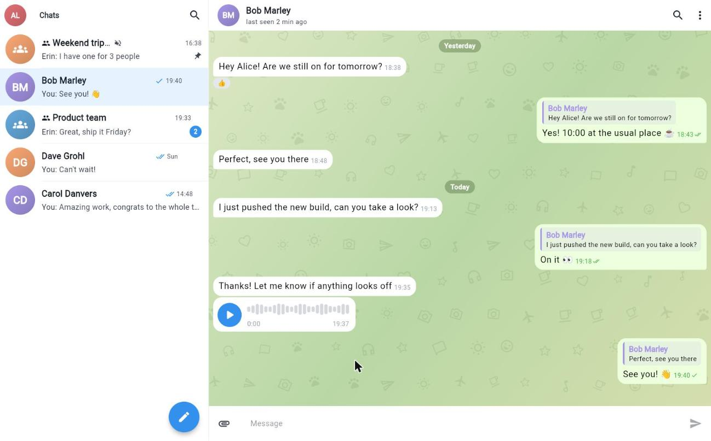

# flutter_supabase_chat_core example

A Telegram-like chat app built on `flutter_supabase_chat_core` and
`flutter_chat_ui` 2.x. It runs on Android, iOS, web, Windows, macOS and Linux.




## Features

- Sign up / sign in (names go into the sign-up metadata, which the database
  copies into the chat profile), "Fill in a demo account" button.
- Chats list: pagination, search, unread badges, pin to top, mute for an hour
  or for ever, leave/delete from a long press.
- New direct chat or group with user search; group info page to rename, add
  and remove members, promote/demote admins, leave or delete the group.
- Conversation: light/dark theme, wallpaper, bubbles with tails, day chips,
  author names and avatars in groups, swipe to reply with quotes, edit,
  delete, copy, reactions, pinned messages banner, read receipts, typing
  indicator, online/last seen status, search in chat with jump to message,
  failed messages with retry.
- Attachments: photos (camera on Android/iOS), files, voice messages with a
  live waveform on every platform, web included.
- Profile: name, avatar, theme mode.
- Two-pane layout (list + conversation) on wide screens.

## Run

You need a Supabase project with the chat schema applied: see the
[main README](../README.md#supabase-setup).

**With `supabase_prepare.sh`/`.ps1`** (in `utils/`): it creates or picks a
project, applies the SQL scripts and writes the gitignored
`lib/supabase_options_for_test.dart` and `lib/main_test.dart`:

```bash
flutter run -t lib/main_test.dart
```

**With any project**, pass its URL and anon/publishable key at build time
(`lib/supabase_options.dart` reads them, no file to edit):

```bash
flutter run --dart-define=SUPABASE_URL=https://<ref>.supabase.co \
            --dart-define=SUPABASE_ANON_KEY=<anon-or-publishable-key>
```

Don't commit real keys in `lib/supabase_options.dart`: it is a tracked
placeholder.

## Demo data on a local stack

From the repository root, with the [Supabase CLI](https://supabase.com/docs/guides/cli/getting-started):

```bash
supabase start
tool/local_db.sh && tool/seed_demo.sh
cd example
flutter run --dart-define=SUPABASE_URL=http://127.0.0.1:54321 \
            --dart-define=SUPABASE_ANON_KEY=<anon key from `supabase status`>
```

Sign in as `alice@demo.dev` / `Demo-password-1` (also `bob@`, `carol@`,
`dave@`, `erin@demo.dev`): direct chats, two groups (one pinned and muted),
replies, reactions, a pinned message, unread messages and a voice message.

## Notes

- `flutter_chat_ui` is pinned to `'>=2.11.1 <2.12.0'`: 2.12.0 moved the
  `Composer` to the experimental `material_ui` package, which crashes inside a
  standard `Scaffold` ("No Material widget found").
- `ChatTheme` is built field by field in `lib/src/theme/app_theme.dart`:
  since `flutter_chat_core` 2.9.1 `ChatTheme.fromThemeData` takes a
  `material_ui` theme, not Flutter's `ThemeData`.
- Voice messages use a custom `AudioMessageBubble`
  (`lib/src/widgets/audio_message_bubble.dart`): the published
  `flyer_chat_audio_message` package has no usable widget yet.
